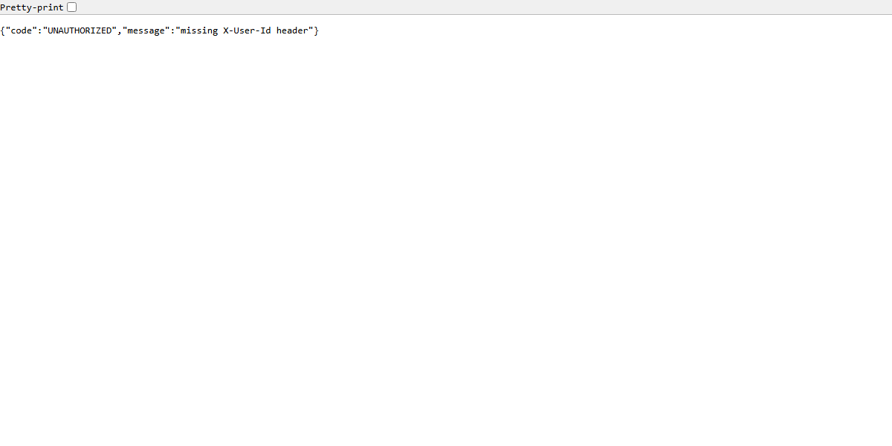

# Docker deployment

StoreOps is packaged as a multi-stage image: Maven compiles/tests the Java 21
application in the build stage, and a Java 21 JRE runs the resulting jar.
The application listens on port 8080 and uses in-memory data.

## Build and start

```powershell
docker compose up --build
```

In another terminal, verify the API is responding. An unauthenticated
request should return the standard 401 response:

```powershell
curl.exe -i http://localhost:8080/api/activities
```

An authenticated request can use a seeded identity:

```powershell
curl.exe -i -H "X-User-Id: u-1" http://localhost:8080/api/activities
```

Stop the foreground service with Ctrl+C. For detached use,
`docker compose up --build -d`; inspect logs with `docker compose logs storeops`
and stop/remove it with `docker compose down`.

## Configuration and limitations

Set `SERVER_PORT` or pass `--server.port=<port>` to change the listening
port. No database volume is required: repositories are in-memory and all
data, including audit data, disappears when the process stops. Do not treat
the current image or audit store as production-ready persistence.

## Runtime screenshot



This is a real headless-browser capture of the running application returning
the expected unauthenticated 401 JSON response. The application was launched
from the Maven-built jar, not from Docker. Docker CLI/daemon is unavailable in
this environment, so the image does not prove that the container build or
container run succeeded. Capture a Docker session here after testing in an
environment with Docker.
